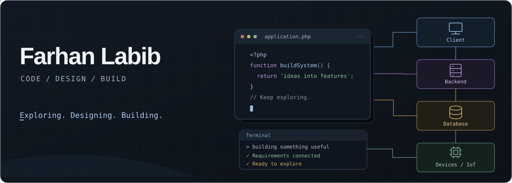

I’m exploring software development through hands-on projects and collaboration. I enjoy understanding how systems work, translating requirements into features, and connecting individual components into a complete application.

---

## Languages & tools

<table>
  <tr>
    <td align="center" width="150">
      
       
      <b>C</b>
    </td>
    <td align="center" width="150">
      
       
      <b>C++</b>
    </td>
    <td align="center" width="150">
      
       
      <b>Java</b>
    </td>
    <td align="center" width="150">
      
       
      <b>PHP</b>
    </td>
    <td align="center" width="150">
      
       
      <b>JavaScript</b>
    </td>
  </tr>
  <tr>
    <td align="center" width="150">
      
       
      <b>HTML</b>
    </td>
    <td align="center" width="150">
      
       
      <b>CSS</b>
    </td>
    <td align="center" width="150">
      
       
      <b>MySQL</b>
    </td>
    <td align="center" width="150">
      
       
      <b>Git</b>
    </td>
    <td align="center" width="150">
      <picture>
        <source media="(prefers-color-scheme: dark)" srcset="https://cdn.simpleicons.org/github/e6edf3" />
        
      </picture>
       
      <b>GitHub</b>
    </td>
  </tr>
</table>

---

## Selected team projects

ThreadFlow — my contributions

My primary work covered production batch management, stage-progress history, bottleneck monitoring, the operational dashboard, and interface modernization for my assigned modules.

| Contribution | Pull request |
| --- | --- |
| Production batch management | [#5](https://github.com/ash01-forge/ThreadFlow/pull/5) |
| Stage-progress history | [#13](https://github.com/ash01-forge/ThreadFlow/pull/13) |
| Bottleneck monitoring | [#21](https://github.com/ash01-forge/ThreadFlow/pull/21) |
| Operational dashboard | [#24](https://github.com/ash01-forge/ThreadFlow/pull/24) |
| Module interface modernization | [#27](https://github.com/ash01-forge/ThreadFlow/pull/27) |

[View team contributions](https://github.com/ash01-forge/ThreadFlow#team-contributions)

 

BookBridge — my contributions

My primary work covered:

- Seller backend APIs and tests.
- Seller dashboard functionality.
- Listing creation and editing.
- Image uploads and sold/relist actions.
- Sales history and related database queries.
- Seller editing and purchase-request workflow fixes.

| Contribution | Pull request |
| --- | --- |
| Seller backend APIs and tests | [#5](https://github.com/ash01-forge/UIU-Used-Textbook-Marketplace/pull/5) |
| Seller workflow fixes | [#8](https://github.com/ash01-forge/UIU-Used-Textbook-Marketplace/pull/8) |
| Seller editing and purchase requests | [#15](https://github.com/ash01-forge/UIU-Used-Textbook-Marketplace/pull/15) |

[Explore the repository](https://github.com/ash01-forge/UIU-Used-Textbook-Marketplace)

 

---

These projects were developed collaboratively. Individual contribution details and team credits are available in the linked repositories.

## Connect

[Connect with me on LinkedIn ↗](https://www.linkedin.com/in/farhan-labib-530402326/)

---

Technology icons: <a href="https://github.com/devicons/devicon">Devicon</a> · <a href="https://simpleicons.org/">Simple Icons</a> · <a href="https://github.com/tandpfun/skill-icons">Skill Icons</a>.
